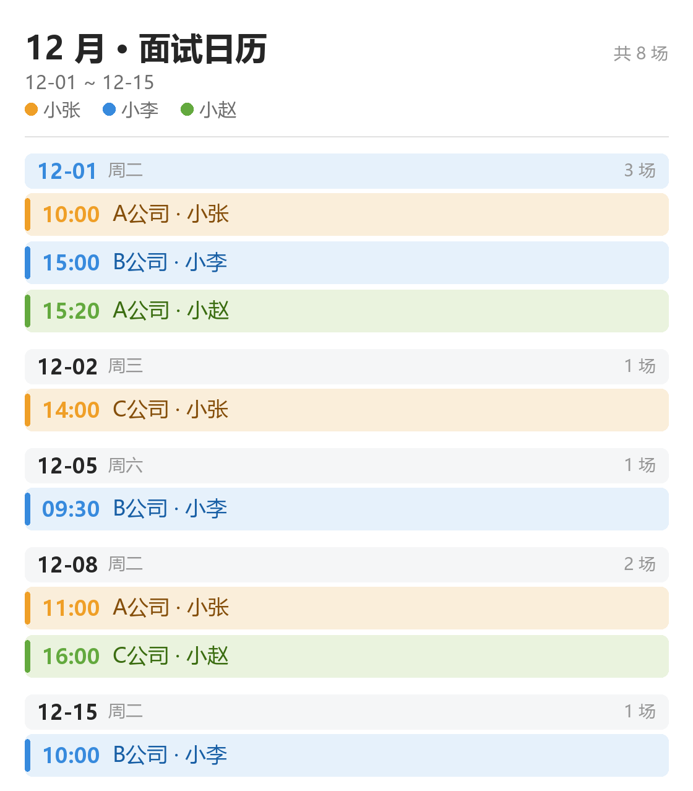

# QQ 群「日程管家」机器人

在 QQ 群里用 `/指令` 或点按钮查看日程、添加行程。纯规则实现，不接大模型。

**当前状态**：机器人「1023 群管家」已接通（AppID `1905782963`），WebSocket 长连接与心跳已验证正常。

## 部署到 Linux 服务器

```bash
git clone <本仓库地址> qq-calendar-bot
cd qq-calendar-bot

cp .env.example .env && vi .env      # 填 AppID / AppSecret（.env 不进版本库）
./deploy/setup.sh                    # 建 .venv、装依赖、检查中文字体
./deploy/run.sh                      # 前台跑，Ctrl+C 停
```

要它常驻（关掉终端也不停、开机自启、崩溃自动拉起）：

```bash
sudo ./deploy/install-service.sh     # 装成 systemd 服务
```

之后：`systemctl restart qq-calendar-bot` 重启、`tail -f bot.log` 看输出、`systemctl disable --now qq-calendar-bot` 停用。

要求 `python3`（≥ 3.8）和 `python3-venv`。Debian/Ubuntu 上如果是裸机：`apt-get install -y python3 python3-venv`。

**唯一容易踩的坑是字体**。日历图是 Pillow 直接画的，需要有中文字形的字体，否则汉字全是方框。`setup.sh` 会把实际认到的字体打在屏幕上，像这样：

```
[font] 正文 /usr/share/fonts/opentype/noto/NotoSansCJK-Regular.ttc [face 2]
       粗体 /usr/share/fonts/opentype/noto/NotoSansCJK-Bold.ttc
```

如果印的是 `⚠️ 没找到可用的中文字体`，装一套即可：

```bash
sudo apt-get install -y fonts-noto-cjk    # Debian / Ubuntu
sudo yum install -y wqy-zenhei-fonts      # CentOS / RHEL
sudo apk add font-noto-cjk                # Alpine
```

也可以自己指定：`export QQ_CAL_FONT=/path/to/字体.ttc`（写进 `.env` 也行）。

> 没有 systemd 的机器（容器、老发行版）用 nohup 顶上：
> `nohup ./deploy/run.sh >> bot.log 2>&1 &`

## 为什么走官方开放平台

QQ 群机器人只有两条路：

| | 官方开放平台（本项目） | 第三方 NapCat / OneBot |
|---|---|---|
| 合规性 | 官方许可，达标可上线 | 违反 QQ 用户协议，有封号风险 |
| 需要一个额外 QQ 号 | 不需要，平台分配机器人身份 | 需要，挂小号扫码登录 |
| 公网 IP / 域名 / 备案 | 不需要（走 WebSocket 长连接） | 不需要（可内网部署） |
| 能否读全量群消息 | 默认只能收到 @机器人 的消息 | 可以读全部消息 |
| 机器人主动推送 | 每群每月仅 4 条 | 不限 |
| 群内定时提醒 | 基本做不了 | 可以 |

你的需求是「被动响应查询 + 添加」，官方平台完全够用，优先选官方。

## 在 QQ 开放平台要做的配置

1. **注册**：打开 <https://q.qq.com/> 用 QQ 登录，选「个人」主体入驻。个人主体现在已支持 QQ 群场景。
2. **创建机器人**：填写名称和头像，进入管理端。
3. **开发设置**：记录 `AppID`，点「生成」得到 `AppSecret`（只显示一次，务必保存）。
4. **配置 IP 白名单**：新增机器人默认启用，填入部署机器的**公网出口 IP**（不要填内网地址）。否则线上无法连接。
5. **配置指令面板**：发布设置 → 功能配置 → 指令配置，把 `/日历` `/加` `/批量` `/删` `/帮助` 填进去。用户在聊天框输入 `/` 就会拉起面板。
6. **拉进群测试**：群主或管理员在「群设置 → 群机器人 → 其他」里添加你的机器人。
7. **提交审核上线**：填写自测报告后提审，审核通过并手动「上线」才能在正式群使用。

看到日志里出现 `机器人「1023 群管家」启动成功！` 和 `心跳维持启动` 就是连上了。

> 在 Windows 上开发的话，双击 `start.bat` 即可（它用 `.venv` 或系统 Python 跑 `bot.py`）。


## 指令

| 指令 | 说明 |
|---|---|
| `/日历` | **出图**，每个有安排的月份各一张竖屏日历图（最多 3 张） |
| `/日历 全部` | **表格**，所有未过期的 |
| `/日历 本周` / `/日历 下周` | 只看这周 / 下周（表格） |
| `/日历 7` | 从今天起 7 天（表格） |
| `/日历 12.31` | 从 12.31 起一周（表格） |
| `/加 12.31 23:59 A公司 小张` | 加一场 |
| `/批量 12.31 10:00 A公司 小张; 12.31 15:00 B公司 小李` | 一次加多场 |
| `/删 12.31 23:59` | 删掉日期+时间对应的那一场 |
| `/帮助` | 指令说明 |

消息底部的按钮，两行四个：

| 按钮 | 回显并发送 |
|---|---|
| **日历** | `/日历`（图片形式，见下） |
| **加一场** | `/加` |
| **批量增加** | `/批量` |
| **删一场** | `/删` |

**@机器人但不带指令时会自动回一份帮助**（帮助只用示例，没有多余说明）：

```
📖 指令示例
　
/日历
　
/加 12.31 23:59 A公司 小张
　
/批量 分号或换行隔开即可
　
/删 12.31 23:59
```

那两个看着像空行、实际是全角空格 `　`（U+3000）的行**不是手滑**，是故意这么写的，两个原因缺一不可：

- **按钮只能挂在 markdown 消息上**。官方文档在「消息按钮」一节写得很直白：「在 markdown 消息的基础上，支持消息最底部挂载按钮」。帮助如果按纯文本发，平台**不报错、也不给按钮**，请求 2xx 返回、正文正常，按钮静默消失——这就是踩过的坑。所以帮助必须走 `msg_type=2`。
- **markdown 渲染会吞掉纯空白行**，空行写进 `content` 里也看不见。全角空格是「有字符的一行」，markdown 会原样保留，肉眼看着正好是一个空行。

代码里对应 `bot.py` 顶部的 `_SEP = "\u3000"` 与 `HELP = ("\n" + _SEP + "\n").join(...)`，要改帮助内容改那个元组即可，不要改用 `\n\n`。

这利用了官方平台的一个既定前提：**机器人默认只收得到 @它 的消息**。所以「收到消息但没解析出指令」就等于「@了它但没说要干什么」，回帮助最合适。如果哪天群主在机器人设置里开了「接收全量消息」，这条规则会让机器人对群里的普通闲聊也回帮助 —— 那时需要加一层 @ 判断。

`/行程` 保留为 `/日历` 的隐藏别名，不想要可以删掉 `dispatch()` 里那个元组项。

### 去重

同一场只会存一条。判重键是 **同群 + 同时间 + 同事项 + 同参与人**（忽略大小写和首尾空格），所以：

- `12.31 10:00 A公司 小张` 重复发两次 → 第二次回「已经在日历里了（编号 N），没有重复加」
- `12.31 10:00 A公司 小张` 大小写/首尾空格不同也算重复（归一后比较）
- `12.31 10:00 A公司 小李` 不重复 → 是另一个人，各自入库
- `12.31 10:00 B公司 小张` 不重复 → 同一时段两场，都保留

两层保障：**数据库表达式唯一索引** `ux_events_unique` 打底，插入前再 `SELECT` 查一次（并发时靠索引兜住）。建索引时如果发现库里有历史重复，会自动清掉多余的那几条并打日志 `[migrate] 已清掉历史重复日程 N 条`。

消息里带的 `@某人` 会展开成 `<@openid>`，属于噪声，解析前统一摘掉，不会混进事项名或人名里。

`/批量` 同样去重：批内重复、与库里已有的重复都会被跳过，但会单独列出来告诉你跳过了哪几条。

### 图片日历

`/日历`（不带参数）直接发图：**每个有安排的月份各一张**，按月份升序，最多 3 张，超出会补一句提示还有几个月。



**为什么是竖屏列表而不是月历网格**：月历网格天生是宽幅的（原来 1056×842），发到手机上被缩到聊天窗口宽度后字就糊了。现在改成**竖向列表**——一天一条，条里是一条条扁平的日程条。

**清晰度靠像素尺寸，不靠 DPI**：PNG 没有「DPI」这回事，DPI 只影响打印尺寸，对屏幕显示毫无作用；屏幕上的清晰度只由像素尺寸决定。手机聊天窗口会按屏宽等比缩放图片，主流手机物理宽 1080px —— 画布只有 560px 宽时会被放大近 2 倍，字就发虚。所以画布按 **2 倍像素**绘制：版式仍按 560px 的逻辑宽度写，实际输出 **1120px 宽**，正好 1:1 落到 1080p 屏上。逻辑尺寸统一乘 `SCALE`（`S()` 换算），要改清晰度只动一个环境变量 `QQ_CAL_SCALE`（默认 2，设 1 回到老尺寸，不会改版式比例）。代价是体积从约 35 KB 涨到约 80 KB，仍远低于平台 5 MB 上限。

- 一天一条：左边日期 `10-14 周三`，右边当天场次 `3 场`；今天那条是浅蓝底 + 蓝字
- 日程条扁平：`10:00 A公司 · 小张`，左侧色条 + 时间用该人的主色，事项用深色
- 每人固定一种颜色，图例在标题下方（`小张` 橙、`小李` 蓝；按人名排序分配，人不变色不变）
- 只画今天及以后的，已经过去的安排不占版面（和表格版一致）
- 高度有三道闸：单天最多 6 条（多的折成「还有 N 场…」）、一张图最多 26 条、总高不超过 1300 逻辑像素（实际 2600px）——太高会被手机缩成看不清的窄带。被砍掉的部分会在图底注明「还有 N 场没画下，用 `/日历 全部` 看表格」
- 多张图共用同一个 `msg_id` 连着回复，所以每条的 `msg_seq` 必须递增——**失败重试也得换号**，服务端把「相同 `msg_id` + `msg_seq`」当重复发送直接拒掉。`safe_reply()` 的三级降级同理，每次重试都换新号

实现在 `render.py`，纯 Pillow 绘制，不依赖无头浏览器，一张约 30 ms、体积约 80 KB。

**图的落盘**：渲染结果会在项目下的 `out/` 留一份，文件名 `cal_<群openid后8位>_<年月>.png` —— 按**月**命名、**同名覆盖**，所以同一个月发多少次 `/日历` 都只占一个文件，不会有重复或堆积。它只是上传用的中间产物（上传走 base64 直传，不需要公网 URL，见下节），留着纯粹是为了出问题时能直接打开看当时画成了什么样。`out/` 已在 `.gitignore` 里，不进仓库；唯一不自动清理的是历史月份的文件（到 11 月，10 月那张还在），但每张约 80 KB，一个群一年最多 12 张 ≈ 1 MB。

### 表格

带范围参数的查询仍用 Markdown 表格：

```
🗓 日历 · 全部 · 12-01 ~ 12-07 · 共 5 场

| 日期 | 星期 | 场次 | 安排 |
|---|---|---|---|
| 12-01 | 周二 | 3 | 10:00 A公司 小张 ｜ 15:00 B公司 小李 ｜ 15:20 A公司 小赵 |
| 12-02 | 周三 | 1 | 15:30 A公司 小张 |
| 12-07 | 周一 | 1 | 14:00 B公司 小李 |
```

按天聚合、自动统计场次、按时间排序。单元格内用全角 `｜` 分隔，不会破坏 Markdown 表格结构。

### 图片是怎么发进群的

QQ 的群聊富媒体有两条上传通道（官方文档 `POST /v2/groups/{group_openid}/files`）：

| 方式 | 要求 | 用哪个 |
|---|---|---|
| URL 上传 | 资源得先在公网可访问 | 不行，我们是本地文件 |
| 二进制直传 | ≤ 5 MB | **用这个**，日历图才 30 KB |
| 分片上传 | 大文件（4 步流程） | 用不上 |

SDK 的 `post_group_file()` 只接受 `url` 参数，传不了本地文件。所以 `upload_group_image()` 直接用 `Route` + `api._http.request` 自己发请求，鉴权和 access_token 刷新仍由 botpy 负责。

**这里有个坑**：`srv_send_msg` 必须传 `False`。传 `True` 虽然一步就能发出去，但会占用「主动消息」频次——每群每月只有 4 条。传 `False` 只拿回 `file_info`，再用 `msg_id` 被动回复，不消耗配额。

### 消息发送的降级

图片路径两级，失败后回落到文字路径的三级，保证一定发得出去：

1. `msg_type=7` + `media` + `keyboard` —— 图片 + 按钮
2. `msg_type=7` + `media` —— 只要图片
3. `msg_type=2` + `markdown` + `keyboard` —— 表格渲染成真表格
4. `msg_type=0` + `content` + `keyboard` —— 退成纯文本（会看到 `|` 原始字符）
5. `msg_type=0` + `content` —— 连按钮也去掉

看服务日志的 `[out]` 标记就知道当前走的哪一级：`图片 + 按钮` / `图片` / `markdown + 按钮` / `纯文本 + 按钮` / `纯文本`。

**只有 markdown 那一级（第 3 级）能带按钮**。官方文档在「消息按钮」里限定得很死：按钮是「在 markdown 消息的基础上，消息最底部挂载」的。第 4、5 级纯文本发出去时，平台既不报错、也不会给按钮——正文照常到达，按钮静默消失。所以那两级只是「正文别丢」的兜底，**不要为了任何别的效果把第 3 级跳过**。

`/加` 的解析规则：按空格切开，第 1 段是日期，第 2 段是时间，**中间所有段拼成事项，最后一段如果有两段以上就当参与人**。
所以 `A公司 小张` → 事项「A公司」、参与人「小张」；只写 `A公司` 则参与人为空。

### 批量增加

一条一条加太慢时用 `/批量`，条目之间用**分号 `;`** 或**换行**分隔（`；` 也认）：

```
/批量 12.31 10:00 A公司 小张; 12.31 15:00 B公司 小李; 12.31 15:20 A公司 小赵
```

每条走的是和 `/加` 完全相同的解析（共用 `parse_add()`，不会出现两套规则打架），所以**部分失败也没关系**——成功的照样入库，失败的单独列出来告诉你哪儿写错了：

```
✅ 批量添加完成：新增 2 条

· 12-31 周四 10:00 A公司 · 小张
· 12-31 周四 15:00 B公司 · 小李

ℹ️ 跳过 1 条已存在的（没重复加）：
· 12-31 周四 15:20 A公司 · 小赵

⚠️ 有 1 条没加进去：
· `瞎写` → 日期「瞎写」没看懂，用 `12.31` 或 `明天` 试试。
```

一次最多 20 条，超了会让你拆开发（消息太长会被截断）。

## 上线前必须知道的限制

- **群里必须 @机器人**，否则收不到消息。除非群主在机器人设置里开启接收全量消息。
- **被动回复窗口**：收到 @消息后 5 分钟内可回复，每条消息最多回复 5 次。超时或超频会静默失败。
- **主动消息配额**：每个群每月只有 **4 条**。所以「每天早上自动播报今日行程」这类定时推送在官方平台做不了，这也是选 NapCat 的唯一理由。
- 消息里如果带 URL，域名必须先在后台「消息 URL 白名单」里报备，否则整条消息发送失败。
- 后台「指令配置」最多 24 个指令，名称不超过 8 个中文字符。
- SDK `qq-botpy` 已停更约两年，仓库是 <https://github.com/tencent-connect/botpy>。
- **Windows 任务管理器里看到两个 `python.exe` 是正常的**：`.venv\Scripts\python.exe` 只是个启动器（venvlauncher），它会再拉起一个真正的 python 子进程，所以「一个实例 = 两个进程」。要确认有没有重复启动，别看进程数，**数 cmd 窗口**——或者查进程的 `ParentProcessId`：父进程是另一个 python 的那两个属于同一个实例。

## 想要「点击按钮直接出结果」？

现在的按钮用的是 `action.type = 2`（把指令回显到输入框，用户回车发送），这样复用同一套指令解析，最稳。

如果想做到点一下直接返回结果，需要改成 `action.type = 1`（回调），然后：

1. `intents` 加上 `interaction=True`
2. 实现 `async def on_interaction_create(self, interaction)`，3 秒内响应，否则客户端一直转圈
3. 从 `interaction.data.resolved.button_data` 取回按钮上绑定的指令，走同一个 `dispatch()`

## 后续可以加什么

- 每天早上把「今日行程」写进一张腾讯文档表格，群里贴链接
- 时段冲突提醒：同一时段已经有安排时给个提示（当前是允许并存的，不同事项不会判重）
- 跨天提醒：行程开始前 30 分钟发一条（需要主动消息配额，或改用 NapCat）
